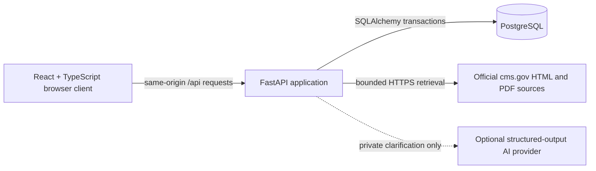

# CMS Quality Intelligence architecture

## System shape

CMS Quality Intelligence is a modular monolith with a separate browser client.
The design keeps evidence and publication rules in one backend while allowing the
public and administrative interfaces to evolve independently.

The containerized local application uses Nginx to serve the compiled React
assets and proxy `/api` and `/health` to FastAPI. Browser code therefore uses
relative URLs and does not need deployment-specific CORS exceptions.

## Component responsibilities

### Frontend

- React, TypeScript, Vite, TanStack Router, and TanStack Query.
- Public browsing and private administrative routes share visual primitives but
  use separate API queries and route boundaries.
- Presentation components do not decide whether CMS evidence is verified or
  publishable. Those decisions remain authoritative in FastAPI.
- Clearly labelled fictional fixtures exist only for intentional demo mode.

### Backend

- FastAPI validates the OpenAPI-defined public and administrative endpoints.
- Service modules own source retrieval, extraction, normalization, ingestion,
  review, and publication rules.
- Public repositories return only published records. Draft candidates and audit
  details are available only through authenticated `/api/admin/...` endpoints.
- The optional AI clarification path proposes evidence-bounded private values;
  it cannot approve or publish them.

### Database

- PostgreSQL stores stable measure identities, performance-year versions,
  source revisions, evidence, candidates, reviews, and ingestion history.
- Alembic owns schema migrations.
- Immutable source hashes and append-only review events preserve provenance.
- There is no patient-level data or PHI in the product model.

### Source processing

1. An authenticated administrator starts a bounded ingestion run.
2. The backend retrieves allowlisted `cms.gov` content with size, redirect, and
   timeout limits.
3. HTML or PDF text is extracted with traceable locators.
4. Content hashes distinguish unchanged documents from immutable new revisions.
5. Deterministic normalization creates private candidates.
6. Human review is required before a field can become public.

## Contracts and trust boundaries

- `openapi.yaml` is the frontend/backend contract and is checked by tests.
- Public and private data are separated in backend queries, not merely hidden in
  the interface.
- Admin sessions are signed, HttpOnly cookies. Production HTTPS deployments must
  set `CMSQI_ADMIN_SESSION_SECURE=true`.
- Official CMS evidence is the factual source of truth. AI output is advisory.
- Missing evidence is represented explicitly and never interpreted as a removed
  measure by absence alone.

## Runtime layouts

### Developer mode

`make dev` starts PostgreSQL in Docker and runs FastAPI and Vite on the host for
fast reloads.

### Reproducible container mode

`make containers` builds three services:

- `postgres`: PostgreSQL 16 with a persistent named volume.
- `backend`: locked `uv` environment, migrations, then FastAPI on port 8000.
- `frontend`: compiled Vite assets served by Nginx on port 5173, with API proxying.

### Deployment

The same images can run behind a managed HTTPS proxy with a managed PostgreSQL
database, or together on a small VM. Production secrets are environment values,
never image layers or repository files.

## Deliberate exclusions

- No microservices: the workload and solo-admin MVP do not justify distributed
  transactions or additional operational complexity.
- No vector database: typed records and evidence locators support the current
  retrieval needs.
- No autonomous publication: source-derived or AI-assisted changes require human
  verification.
- No cloud-specific code in the domain layer: deployment selection should not
  determine evidence or review behavior.
